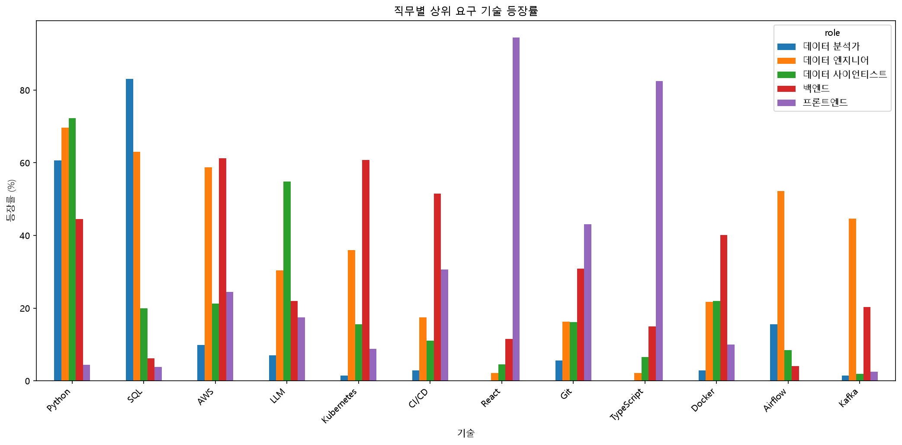
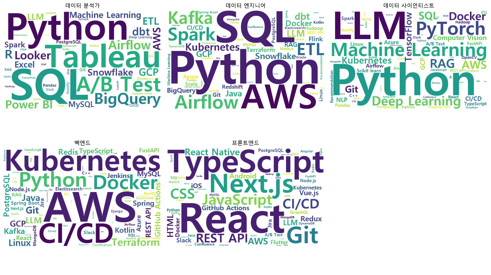
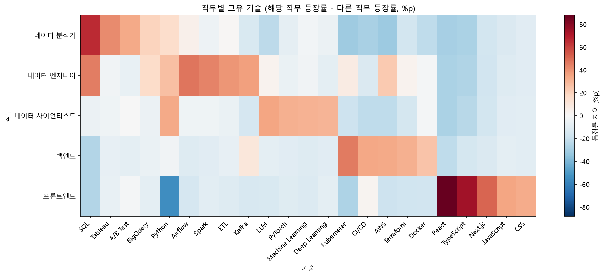
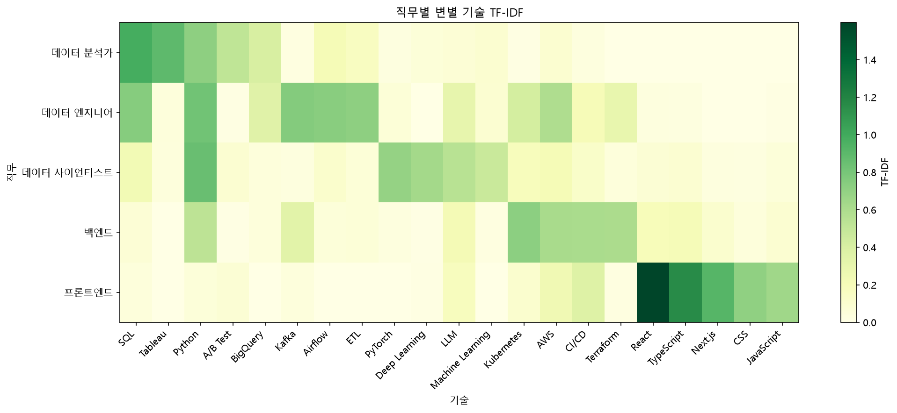
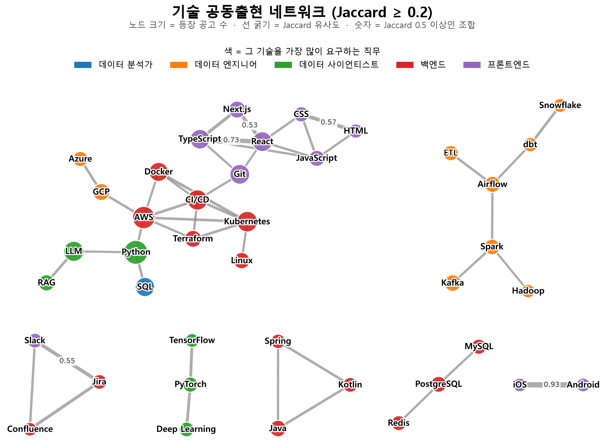
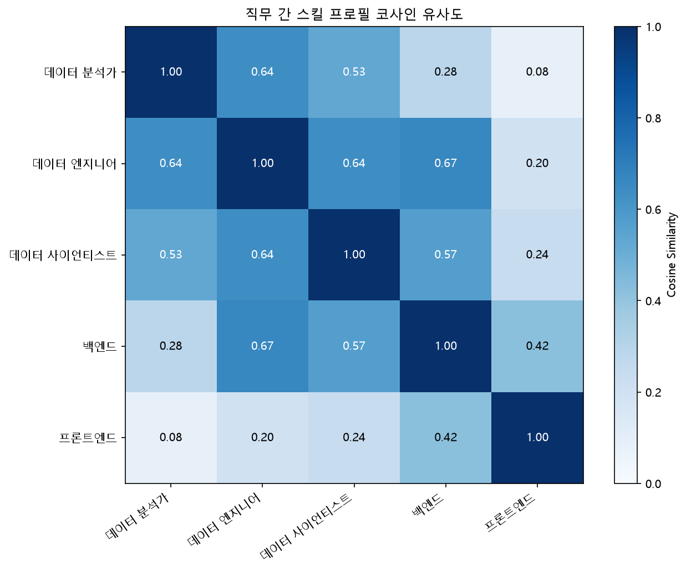

# 채용공고 기반 직무별 요구 기술 분석

데이터 분석가 공고는 Python(61%)보다 SQL(83%)을 더 자주 요구했고, 프론트엔드 공고의 94%는 React를 요구했습니다. 원티드(Wanted) 채용공고 1,273건을 직접 수집해 5개 직무로 분류하고, 기술 90개의 등장률과 공동출현을 분석했습니다.

| 수집 / 분석 대상 | 데이터 분석가 SQL 요구 | LLM 언급 공고 |
|:---:|:---:|:---:|
| 1,273건 / 705건 | 83% (Python 61%) | 196건 / 705건 |

**[내 기술로 확인해 보기 (웹 앱)](https://job-posting-tech-analysis.streamlit.app/)** · **[스토리 페이지](https://kangmunju.github.io/job-posting-tech-analysis/docs/story.html)** · [분석 보고서](reports/analysis_report.md) · [주요 인사이트](reports/FINDINGS.md)

내가 쓸 수 있는 기술을 고르면 직무별 매칭 점수와 다음에 배우면 좋은 기술을 보여 줍니다. 분석 결과를 그대로 쓰며 예측 모델은 아닙니다.

---

## 프로젝트 요약

### 어떻게 진행했나

원티드 API로 5개 직무 카테고리의 공고 ID를 모았습니다. 카테고리 목록을 합치면 1,401건인데, 한 공고가 여러 카테고리에 걸려 있어서 `job_id`로 중복을 지우니 1,273건이 남았습니다. 상세 수집은 한 건도 실패하지 않았습니다.

SQLite에는 `job_id`를 기본키로 UPSERT해서 적재했고, 같은 CSV를 다시 넣어도 행 수가 유지되는 것을 확인했습니다. `job_id`가 달라도 같은 회사가 같은 제목으로 다시 올린 공고 6건은 최신 공고만 남겼습니다(1,267건). 분석 텍스트로는 자격요건, 우대사항, 주요업무 세 필드만 썼습니다.

### 어떻게 추출·분석했나

원티드 카테고리에는 인접 직무가 섞여 있어서 공고 제목 정규식으로 직무를 다시 나눴습니다. 프론트엔드와 백엔드가 섞이는 풀스택 공고 86건은 따로 분리해 분석에서 제외했고, 705건이 5개 직무에 들어갔습니다. 기술은 표준명 90개와 별칭 211개로 만든 사전으로 뽑아 공고 × 기술 0/1 행렬(705×90)을 만들었습니다. 공고 하나에서 평균 7.0개 기술이 잡혔습니다.

직무별 공고 수가 71~227건으로 달라서 건수 대신 등장률을 기준으로 삼았고, 비율에는 Wilson 95% 신뢰구간을 함께 계산했습니다. 직무를 구별하는 기술은 TF-IDF와 "해당 직무 등장률 − 다른 직무 등장률(%p)"로, 같이 요구되는 기술은 Jaccard로, 직무끼리의 기술 구성은 코사인 유사도로 비교했습니다. 같은 공고 안에서 두 기술을 비교할 때는 McNemar 검정을, 경력 구간 비교에는 Kruskal-Wallis 검정을 썼습니다.

분류와 기술 추출은 결과를 만든 뒤 표본 점검으로 검증했습니다. 제외된 공고 50건을 무작위로 뽑아 분석 대상이 섞여 있는지 보고 규칙을 보강했고(누락 24% → 6%), 상위 기술 35개의 매칭 문장 약 300개를 확인했습니다. 이 과정에서 `뷰`가 `리뷰`·`웹뷰`까지 Vue.js로 잡던 문제, 대문자 `ETL`이 한 건도 집계되지 않던 문제 등을 찾아 고쳤습니다. 모듈별 자체 테스트 71개는 모두 통과합니다. 자세한 내용은 [분석 보고서](reports/analysis_report.md)의 2.3에 정리했습니다.

### 그래서 결과는

직무마다 1위 기술이 달랐습니다. 데이터 분석가는 SQL 83%, 데이터 엔지니어는 Python 70%, 데이터 사이언티스트는 Python 72%, 백엔드는 AWS와 Kubernetes가 61%, 프론트엔드는 React 94%입니다. Python은 어느 직무에서나 많이 나오기 때문에, 직무를 구별하는 기술은 등장률 차이로 따로 봤습니다. 데이터 엔지니어에서는 Python보다 Airflow(+47%p), Spark(+44%p), ETL(+39%p), Kafka(+36%p)가 더 뚜렷했습니다.

LLM은 705건 중 196건에 나왔습니다. 데이터 사이언티스트의 등장률이 55%로 가장 높았지만, LLM이 나온 공고의 57%는 데이터 사이언티스트가 아닌 직무의 공고였습니다. 가장 자주 함께 요구된 조합은 TypeScript와 React였습니다(154건, Jaccard 0.733). 경력이 높아져도 공고당 기술 수는 6.4개에서 7.2개로 크게 늘지 않았고, 차이는 통계적으로 유의하지 않았습니다(p = 0.055).

---

## 1. 프로젝트 개요

IT 직무를 준비할 때 어떤 기술을 우선적으로 학습해야 하는지 객관적인 근거를 마련하기 위해 진행했습니다.

채용공고에 등장하는 기술을 추출하고, 직무별 기술 등장률과 TF-IDF, 직무 고유 기술, 공동출현 관계 등을 분석했습니다.

| 항목 | 내용 |
|---|---|
| 데이터 출처 | 원티드(Wanted) |
| 수집 공고 | 1,273건 (재게시 공고 정리 후 1,267건) |
| 최종 분석 공고 | 705건 |
| 분석 직무 | 데이터 분석가, 데이터 엔지니어, 데이터 사이언티스트, 백엔드, 프론트엔드 |
| 기술 사전 | 표준 기술명 90개, 별칭 211개 |
| 분석 언어 | Python |
| 데이터 저장 | CSV, SQLite |

## 2. 프로젝트 진행 과정

1. 원티드 채용공고 API를 활용한 데이터 수집
2. SQLite 데이터베이스 적재 및 중복 검증 (`job_id`, 회사 + 제목 기준)
3. 공고 제목을 기준으로 5개 직무 재분류 (풀스택 분리)
4. 제외된 공고 표본 점검으로 직무 분류 규칙 보강
5. 스킬 사전 기반 기술명 추출 및 표본 점검으로 사전 오탐·누락 수정
6. 직무별 기술 등장률 분석
7. TF-IDF와 등장률 차이(%p)를 활용한 직무별 특징 기술 분석
8. 공동출현 횟수 및 Jaccard 유사도 분석
9. LLM 요구 현황, 경력별 기술 수, 직무 간 코사인 유사도 분석 및 통계 검정
10. 결과 시각화 및 인사이트 도출

## 3. 주요 분석 결과

### 3.1 직무별 핵심 요구 기술

| 직무 | 1위 | 2위 | 3위 |
|---|---|---|---|
| 데이터 분석가 | SQL (83%) | Python (61%) | Tableau (42%) |
| 데이터 엔지니어 | Python (70%) | SQL (63%) | AWS (59%) |
| 데이터 사이언티스트 | Python (72%) | LLM (55%) | Machine Learning (34%) |
| 백엔드 | AWS (61%) | Kubernetes (61%) | CI/CD (52%) |
| 프론트엔드 | React (94%) | TypeScript (82%) | Next.js (54%) |

**직무별 주요 기술 등장률 시각화**



위 그래프는 직무별로 주요 기술이 채용공고에 등장하는 비율을 비교한 결과입니다.

**주요 기술 키워드 워드클라우드**



워드클라우드는 채용공고에 등장하는 주요 기술 키워드를 시각적으로 표현한 자료입니다. 기술별 등장 빈도를 직관적으로 파악하는 데 활용할 수 있습니다.

### 3.2 직무를 구별하는 기술

TF-IDF는 직무 5개를 비교 단위로 계산해서 결과가 등장률 순위를 거의 그대로 따라갑니다. 그래서 데이터 엔지니어의 1위가 모든 데이터 직무에서 흔한 Python으로 나옵니다. 이를 보완하려고 해당 직무의 등장률에서 다른 직무 공고 전체의 등장률을 뺀 값(%p)을 함께 계산했습니다.

| 직무 | TF-IDF 1위 | 등장률 차이 1위 | 등장률 차이 2위 | 등장률 차이 3위 |
|---|---|---|---|---|
| 데이터 분석가 | SQL | SQL (+66%p) | Tableau (+41%p) | A/B Test (+33%p) |
| 데이터 엔지니어 | Python | Airflow (+47%p) | SQL (+45%p) | Spark (+44%p) |
| 데이터 사이언티스트 | Python | LLM (+35%p) | Python (+33%p) | PyTorch (+31%p) |
| 백엔드 | Kubernetes | Kubernetes (+46%p) | CI/CD (+34%p) | AWS (+33%p) |
| 프론트엔드 | React | React (+88%p) | TypeScript (+74%p) | Next.js (+51%p) |

**직무별 고유 기술 등장률 차이 히트맵**



빨간색은 해당 직무에서 다른 직무보다 더 많이 요구되는 기술, 파란색은 덜 요구되는 기술입니다.

**직무별 특징 기술 TF-IDF 히트맵**



히트맵은 직무별 기술의 TF-IDF 점수를 시각화한 것으로, 점수가 높을수록 해당 직무에서 상대적으로 두드러지는 기술임을 나타냅니다.

### 3.3 주요 기술 조합

| 기술 조합 | 공동출현 횟수 | Jaccard 유사도 |
|---|---:|---:|
| TypeScript + React | 154건 | 0.733 |
| Python + AWS | 144건 | 0.316 |
| AWS + CI/CD | 131건 | 0.383 |
| AWS + Kubernetes | 131건 | 0.373 |
| Python + SQL | 126건 | 0.341 |

**기술 공동출현 네트워크**



네트워크 그래프는 채용공고에서 함께 요구되는 기술 간의 관계를 나타냅니다. 노드는 개별 기술(크기는 등장 공고 수, 색은 그 기술을 가장 많이 요구하는 직무), 연결선은 두 기술의 공동출현 관계(굵을수록 Jaccard가 높음)를 의미합니다.

## 4. 주요 인사이트

### 인사이트 1. 데이터 분석가는 Python보다 SQL을 더 자주 요구한다

데이터 분석가 공고 71건 중 SQL은 59건(83.1%, 95% 신뢰구간 73~90%), Python은 43건(60.6%, 49~71%)에서 등장했습니다.

SQL의 등장률은 Python보다 약 22.5%p 높았습니다. 같은 공고 안에서 비교하면 SQL만 요구한 공고가 20건, Python만 요구한 공고가 4건이었고, McNemar 정확검정 결과 p = 0.002였습니다.

### 인사이트 2. LLM은 데이터 사이언티스트 외 직무에서도 요구된다

전체 705건 중 196건에서 LLM이 등장했습니다.

데이터 사이언티스트의 LLM 등장률은 55%로 가장 높았고 등장 공고 수도 85건으로 가장 많았습니다. 그러나 LLM이 나온 공고의 57%(111건)는 데이터 엔지니어(30%), 백엔드(22%), 프론트엔드(18%) 같은 다른 직무의 공고였습니다.

데이터 사이언티스트 분류 규칙에 제목의 `LLM`이 들어 있어서, 해당 직무의 LLM 공고 85건 중 16건은 분류 단계에서 이미 LLM이 반영된 공고입니다.

### 인사이트 3. 경력에 따른 요구 기술 수의 차이는 크지 않다

- 0~1년: 평균 6.4개
- 2~4년: 평균 7.1개
- 5년 이상: 평균 7.2개

경력 수준이 높아질수록 평균 기술 수는 소폭 높아졌지만, 평균 차이(0.8개)가 구간별 표준편차(4.0~4.6개)보다 훨씬 작았습니다. Kruskal-Wallis 검정에서도 5% 유의수준에서 유의하지 않았습니다(p = 0.055, 경계에 가까운 값).

### 인사이트 4. 데이터 엔지니어는 여러 직무와 유사한 기술 구성을 보인다

데이터 엔지니어의 기술 등장률 패턴은 백엔드(0.67), 데이터 분석가(0.64), 데이터 사이언티스트(0.64)와 비교적 높은 코사인 유사도를 보였고, 그중 백엔드와 가장 유사했습니다.

**직무 간 기술 요구 패턴 유사도**



직무별 기술 등장률 벡터의 코사인 유사도를 비교한 결과입니다. 값이 1에 가까울수록 두 직무에서 요구하는 기술의 분포가 유사하다는 의미입니다.

## 5. 사용 기술

| 구분 | 기술 |
|---|---|
| 언어 | Python |
| 데이터 수집 | requests |
| 데이터 처리 | pandas |
| 수치 계산·통계 | NumPy, SciPy |
| 데이터베이스 | SQLite |
| 시각화 | Matplotlib, WordCloud, NetworkX |
| 분석 기법 | TF-IDF, 등장률 차이, 공동출현 분석, Jaccard 유사도, 코사인 유사도, Wilson 신뢰구간, McNemar·Kruskal-Wallis 검정 |
| 버전 관리 | Git, GitHub |

## 6. 주요 파일

| 파일 | 설명 |
|---|---|
| `run_all.py` | 자체 테스트, DB 적재, 직무 분류, 분석 5개를 한 번에 실행하고 로그 저장 |
| `src/collect_wanted.py` | 원티드 채용공고 수집 |
| `src/build_db.py` | CSV 데이터 SQLite 적재 (재게시 공고 정리 포함) |
| `src/db.py` | 데이터베이스 관리 |
| `src/classify.py` | 공고 제목 기반 직무 재분류 |
| `src/skills.py` | 스킬 사전과 기술 추출 |
| `src/preprocess.py` | 공고 텍스트 전처리 |
| `analysis/a1_eda.py` ~ `a5_insights.py` | 탐색, 등장률, 직무 고유 기술, 공동출현, 인사이트 분석 |
| `outputs/logs/` | 각 단계의 실행 로그와 실행 환경(Python·패키지 버전) |
| `reports/analysis_report.md` | 주요 분석 방법 및 결과 보고서 |
| `reports/FINDINGS.md` | 4가지 핵심 인사이트 |
| `reports/DATA_ACCESS.md` | 데이터 접근 및 수집 기록 |

## 7. 분석 결과 문서

- [분석 보고서](reports/analysis_report.md)
- [주요 인사이트](reports/FINDINGS.md)
- [데이터 접근 및 수집 기록](reports/DATA_ACCESS.md)

## 8. 데이터 공개 및 재현성

원본 채용공고 CSV, 상세 JSON 캐시 및 SQLite 데이터베이스는 Git 추적 제외 대상으로 관리하며, Git 이력에서도 제거했습니다. 원본 데이터는 재배포하지 않고 집계 결과만 공개합니다. 수집 방식과 원티드 이용약관 확인 내용은 [데이터 접근 및 수집 기록](reports/DATA_ACCESS.md)에 정리했습니다.

### 8.1 라이브러리 설치

프로젝트 최상위 폴더에서 필요한 Python 라이브러리를 설치합니다.

```bash
python -m pip install -r requirements.txt
```

Python 3.14.6(Windows 11)에서 검증했고, 라이브러리는 결과를 만들 때 사용한 버전으로 고정했습니다. 다른 Python 버전에서는 고정한 버전을 설치하지 못할 수 있습니다.

### 8.2 데이터 수집에 대한 안내

분석에 사용한 채용공고는 원티드 API(`/api/v4/jobs`)로 2026-09-17에 한 번 수집했습니다. 다만 원티드의 robots.txt 사본(2026-02-06)은 `/api/` 경로의 자동 수집을 허용하지 않고, 이용약관도 자동화된 수집과 정보의 제3자 제공을 제한합니다. 그래서 **재수집은 권하지 않습니다.** `src/collect_wanted.py`는 수집 방법을 기록하기 위해 공개한 것이며, 실행하려면 원티드의 허락을 먼저 확인해야 합니다. 자세한 내용은 [데이터 접근 및 수집 기록](reports/DATA_ACCESS.md)의 7.4에 정리했습니다.

### 8.3 전체 분석 실행

원본 CSV(`data/raw/wanted_jobs.csv`)가 준비된 환경에서는 다음 명령어 하나로 자체 테스트, DB 적재, 직무 분류, 분석 5개를 순서대로 실행합니다.

```bash
python run_all.py
```

각 단계의 실행 결과는 `outputs/logs/`에 저장되고, 분석 결과는 `models/` 및 `outputs/` 폴더에 저장됩니다. 하나라도 실패하면 그 단계에서 멈춥니다.

단계별로 직접 실행하려면 다음 순서대로 실행합니다.

```bash
python src/build_db.py
python analysis/a1_eda.py
python analysis/a2_skill_frequency.py
python analysis/a3_tfidf_distinctive.py
python analysis/a4_cooccurrence.py
python analysis/a5_insights.py
```

각 분석 스크립트의 역할은 다음과 같습니다.

| 파일 | 분석 내용 |
|---|---|
| `a1_eda.py` | 데이터 탐색 및 기초 통계 |
| `a2_skill_frequency.py` | 직무별 기술 등장률 분석 |
| `a3_tfidf_distinctive.py` | TF-IDF와 등장률 차이(%p) 기반 직무별 특징 기술 분석 |
| `a4_cooccurrence.py` | 기술 공동출현 및 Jaccard 유사도 분석 |
| `a5_insights.py` | LLM 요구 현황, 경력별 기술 수 및 직무 간 유사도 분석, 통계 검정 |

### 8.4 재현성 관련 주의사항

같은 CSV로 `python run_all.py`를 두 번 실행해 `models/`와 `outputs/`의 결과 파일이 모두 동일한지 확인했습니다. 새 가상환경에서 `requirements.txt`로 설치한 뒤 실행해도 결과 파일이 모두 동일했습니다. 워드클라우드의 단어 배치는 `random_state`를 고정해 재현되도록 했습니다.

다만 외부 API의 접근 정책이나 채용공고 내용은 변경될 수 있으므로 새로 수집한 데이터에서는 동일한 결과가 나오지 않을 수 있습니다. 또한 원본 데이터와 SQLite 데이터베이스는 GitHub에 공개하지 않으므로, 저장소만으로는 분석을 처음부터 다시 실행할 수 없습니다. 대신 분석 결과(`models/`, `outputs/`), 각 단계의 실행 로그(`outputs/logs/`), 분석 코드를 공개하며, 웹 앱에서 결과를 직접 확인할 수 있습니다.

## 9. 분석의 한계

- 원티드 단일 플랫폼의 채용공고를 분석했습니다.
- 직무별 분석 공고 수가 71~227건으로 서로 다르고, 데이터 분석가는 71건으로 표본이 작습니다.
- 직무는 공고 제목으로 분류했습니다. 제외된 공고를 표본으로 점검했을 때 규칙으로 잡을 수 있는 누락은 약 6%였지만, 제목에 직무 키워드가 없는 공고는 일부 누락될 수 있습니다. 풀스택 공고는 분석에서 제외했습니다.
- 스킬 사전 기반 추출이므로 등록되지 않은 기술은 누락될 수 있습니다.
- 기술의 등장 여부만으로 실제 요구 숙련도나 업무 중요도를 판단할 수 없습니다.
- 여러 지표에 검정을 수행했지만 다중 비교 보정은 하지 않아 p값은 참고용입니다.
- 분석 결과는 채용시장 전체의 수요나 실제 채용 성과를 직접적으로 설명하지 않습니다.

## 10. 프로젝트 결론

IT 직무별로 요구되는 기술에는 차이가 있으며, 기술의 등장률과 다른 직무와의 차이, 함께 요구되는 기술 조합을 종합적으로 고려하는 것이 중요합니다.

본 프로젝트는 채용공고 데이터를 활용하여 직무별 기술 요구 패턴을 정량적으로 비교하고, 취업 준비 과정에서 기술 학습 우선순위를 결정하는 데 참고할 수 있는 근거를 제시합니다.
